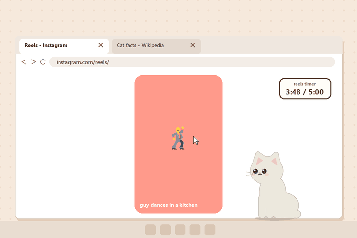
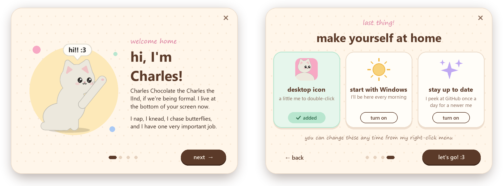
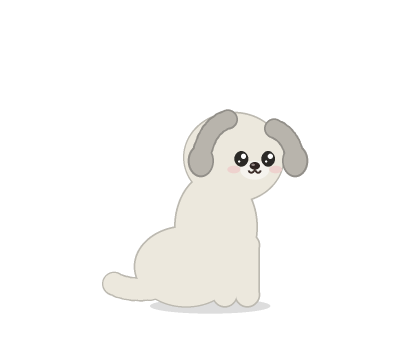
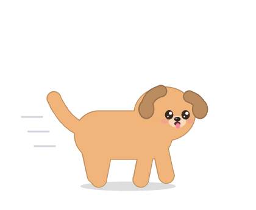

<div align="center">

# Charles Chocolate the Charles the IInd

**A small, soft, slightly judgemental cat who lives on your Windows desktop.**
She naps, she kneads, she chases butterflies, and if you scroll Reels for five
whole minutes she will walk over and close the tab herself.



<sub>Sped up. Rendered by her own drawing code (<code>tools/make_demo.py</code>) over a pretend browser.</sub>

[**Download Charles.exe**](https://github.com/yad2thisyazm/charles-chocolate-the-charles-the-2nd/releases/latest/download/Charles.exe) ·
[**Meet Charles →**](https://yad2thisyazm.github.io/charles-chocolate-the-charles-the-2nd/) ·
[Privacy](#privacy)

</div>

---

## What she does

| | |
|---|---|
|  | **Exists adorably.** Wanders around the bottom of your screen, sits, blinks, flicks an ear, and follows your cursor with her eyes. |
|  | **Makes biscuits.** Kneads with both paws while little purr-notes float up. |
|  | **Chases butterflies.** Watches one flutter by, swats at it, and misses. Every time. |
|  | **Loafs.** Curls up for a nap. Do not wake her. |
|  | **Loves pets.** Wiggle your cursor gently over her and she purrs and makes hearts. |
|  | **Hates pokes.** Click her and she puffs up. Poke her five times and she storms off to the other side of the screen. |
|  | **Gets dizzy.** Pick her up and shake her around and she lands with spinning eyes and stars. |

### The Reels Rule

Charles has one job. If you spend **5 minutes** scrolling **Instagram Reels,
YouTube Shorts, TikTok or Facebook Reels**:

1. at **4:00** she warns you: *"one more minute of reels..."*
2. at **5:00** she runs over, jumps up, hangs off your browser tab and **swats it closed**.
3. she lands, and says something like *"go touch grass :3"*.

#### Make it your rule

Right-click her → **Reels rules**:

| Setting | Options | Default |
|---|---|---|
| Time limit | 2, 5, 10, 15 or 30 minutes | 5 minutes |
| Warning | 30 seconds, 1 minute or 2 minutes before, or no warning | 1 minute before |
| When time's up | **Close the tab**, **Block scrolling** (she sits by the window and swallows scroll-wheel and arrow / Page keys in every reels window until you've been away for a minute) or **Just tell me off** | Close the tab |

Settings are saved to `desk_cat_settings.json` next to `desk_cat.py`, or
`%APPDATA%\Charles Chocolate\settings.json` for the .exe. You can edit the file for
any value the menu doesn't offer (e.g. `"limit_minutes": 7`). If something in it doesn't make sense, she uses the default for that setting and tells you which one when she starts.

#### She never guesses

Closing the wrong tab would be worse than closing none, so before she touches anything she
checks that:

- the browser's address bar really shows a reels address: the exact site and path, so
  `instagram.com/reelsofindia` or a Google search for "tiktok.com" don't count, and a page
  merely *titled* "reels" isn't enough,
- the tab she's about to swat is the selected tab **and** its name matches the reels page,
- right before she presses, she finds that tab again (in case you switched tabs while she was
  running over) and checks the address bar *still* shows reels,
- the button she presses is the tab's **Close** button, not the mute button next to it. If she
  can't tell which is which, she uses <kbd>Ctrl</kbd>+<kbd>W</kbd> instead, and never while
  you're holding a key (<kbd>Ctrl</kbd>+<kbd>Shift</kbd>+<kbd>W</kbd> would close the whole window).

If any of that can't be confirmed (an unusual browser, a page that won't expose its tabs,
UI Automation unavailable), she **doesn't close anything**. She tells you she couldn't find the
reels tab safely and blocks scrolling in every reels window instead. Desktop apps are only closed
if the program itself is TikTok or Instagram, never because some other window's title mentions
them, and she never closes a whole browser window.

Fine print:

- Only time spent **actively scrolling** counts (mouse wheel over the reels, or arrow / Page / Space / J / K keys in it, at least once every 45 seconds).
- A break of more than a minute resets the timer.
- She watches the focused window *and* whatever window is under your mouse, so screen recorders stealing focus won't fool her.
- Works in Chrome, Edge, Brave, Firefox, Opera, Vivaldi, Arc, Zen, Chromium, Thorium, LibreWolf, Waterfox and Floorp, plus the TikTok / Instagram desktop apps.

#### Known limits

- **The TikTok and Instagram apps from the Microsoft Store** may run inside Edge on newer Windows.
  If so, she can't tell them from a browser window with no address bar, so instead of closing
  them she blocks scrolling.
- **Fullscreen (F11) and installed web apps** hide the address bar. She falls back to the window
  title, which catches Reels and TikTok but often misses Shorts. She never closes anything she
  found this way, only blocks scrolling.
- **Touchscreen swipes** and clicking the on-screen next/previous arrows don't count as scrolling.

## Install

Charles is **Windows only** (10 or 11).

### The easy way

1. Download [**Charles.exe**](https://github.com/yad2thisyazm/charles-chocolate-the-charles-the-2nd/releases/latest/download/Charles.exe).
2. Double-click it. No Python, no installer, nothing else to set up.
3. The first time, she shows you a short tour, with buttons to put her icon on your desktop
   and to start her with Windows. (Right-click her → **How I work** to see it again.)

<p align="center"></p>

The .exe isn't code-signed, so Windows SmartScreen may say *"Windows protected your PC"*.
Click **More info → Run anyway**. If you'd rather not trust a binary, build it yourself
(below) or run from source.

### Updating

**The easy way:** turn on **Check for updates** (in her first-run tour, or right-click her).
Once a day she asks GitHub if there's a newer Charles. If there is, she tells you, and
right-click → **Update me** downloads it, checks it's the real file (size and SHA-256 from
GitHub), swaps it in and restarts as the new version. It's off until you turn it on.

**By hand:** download the new `Charles.exe` and open it. The Charles who's already running steps
aside for the new one, and her desktop icon and **Start with Windows** follow the new copy.
Then you can delete the old .exe.

Either way your coat, size and reels rules are kept: they live in
`%APPDATA%\Charles Chocolate`, not in the .exe.

Coming from v1.0.0? That version doesn't know how to step aside, so right-click it →
**Bye Charles (quit)** first.

Running from source? Update with `git pull`; the update check is only in the .exe.

### From source

Needs **Python 3.10+**.

```bash
git clone https://github.com/yad2thisyazm/charles-chocolate-the-charles-the-2nd.git
cd charles-chocolate-the-charles-the-2nd
pip install -r requirements.txt
pythonw desk_cat.py
```

`pythonw` runs her without a console window. Right-click → **Start with Windows** works from
source too.

### Build the .exe yourself

```bash
pip install -r requirements.txt pyinstaller
python tools/build_exe.py      # -> dist/Charles.exe
```

Pushing a `v*` tag runs the same build on GitHub Actions and attaches `Charles.exe` to a release.

## Using her

| Do this | She does this |
|---|---|
| Wiggle your cursor gently over her | Purrs, hearts |
| Left-click | Gets offended |
| Left-click 5 times quickly | Leaves |
| Left-click the puppy | *Woof!* (a very small woof, a little bark, and woof stickers pop off him) |
| Left-click the puppy 5 times quickly | Zoomies |
| Drag | Dangles, then drops back onto the taskbar |
| Drag and shake | Dizzy |
| Right-click | Menu: reels timer, reels rules, skin, coat, size, woof sounds, start with Windows, desktop icon, how I work, test mission, quit |

**Coats:** Mochi (white), Ash (grey), Midnight (black), Ginger, Cream, Blue, Chocolate.

**Skins:** Kitty, or Puppy (right-click → **Skin**): floppy ears, a wagging tail, a little
tongue when he's happy. Poke the puppy and he goes *woof!* instead of getting cross; poke
him five times and he gets the zoomies. Every coat works on both. His woof is tiny and quiet;
turn it off with right-click → **Woof sounds**.

<p align="center"></p>

**Sizes:** Small, Medium, Large. Your choices are saved with the rest of her settings.

### Testing the Reels Rule

Right-click → **Test the reels mission**. Now any reels page that's open for **20 seconds**
(scrolling or not) gets closed. It stays armed until she's closed something, so you can set
up a screen recording first and open reels after.

You can also run `python desk_cat.py --test` to shrink the real timer to 20 seconds.

## Privacy

Charles watches what you're looking at, so here is exactly what she does with it.

**What she looks at**

| What | Why | How often |
|---|---|---|
| The title and program name of the focused window, and of the window under your mouse | To tell if it's a browser or the TikTok / Instagram app | Once a second |
| The address bar text of that browser window | To tell if it's a reels page | Once a second, browsers only |
| *That* you scrolled (mouse wheel, ↑ ↓ Page Space J K keys) in a reels window, not where or what | Only *active* scrolling counts towards the limit | As it happens |
| The browser's tab strip | To find the reels tab's close button | Only at the moment she intervenes |
| Your cursor position | So her eyes can follow it, and for petting | Every frame |
| GitHub's latest release number | To tell you about a newer Charles | Once a day, only if you turn on **Check for updates** (off by default) |

**What she keeps:** a reels timer in memory, reset when you take a break or quit. She never
stores URLs, titles or history. The only thing written to disk is her settings file (skin,
coat, size, reels rules, and whether you've seen her tour and turned on update checks), plus, while
updating, the new .exe next to the old one. The `uiautomation` library may write an `@AutomationLog.txt` next to her
with technical errors only.

**What leaves your computer:** nothing. No analytics, no telemetry. The only network
connection she ever makes is the update check, and only if you turn on **Check for updates**:
once a day she asks GitHub's public releases page for the latest version number (sending
nothing about you beyond what any web request does, like your IP address), and downloads the
new .exe from GitHub only when you click **Update me**. With it off (the default) she makes no
network connections at all. It's one Python file, so you can check.

**What permissions she needs:** none beyond a normal app. She runs as you, without admin
rights. She uses:

- **Windows UI Automation**, the accessibility API screen readers use, to read the address bar
  and press the tab's close button.
- **Low-level mouse and keyboard hooks**, to notice scrolling and, in block mode, to stop it.
  Like any keyboard hook, Windows passes every key press through it. Hers ignores everything
  except the keys that move a reels feed (↑ ↓ Page Up / Down, Home, End, Space, J, K), and only
  while a reels window is in front. She only *swallows* the scroll keys (not Space, J or K), and
  only when you've chosen **Block scrolling**. She never records,
  stores or sends what you type.
- **A simulated Ctrl+W**, only as a fallback when the close button can't be pressed directly,
  only after re-confirming the reels window is in front and still on reels, and never while
  you're holding a key.
- **One registry value** (`HKCU\...\CurrentVersion\Run\Charles Chocolate`), only if you tick
  **Start with Windows**. Untick it to remove it.
- **A desktop shortcut**, only if you ask for one (in her first-run tour, or right-click →
  **Desktop icon**). Untick it to remove it.

To remove her completely: untick **Start with Windows** and **Desktop icon**, quit, delete the
.exe (or folder), and delete `%APPDATA%\Charles Chocolate`.

## How she works

It's one Python file. She's drawn from scratch every frame with Pillow (supersampled
circles, rounded polygons and bezier "tubes"), and shown in a transparent, always-on-top
layered window. A background thread uses Windows UI Automation to read the browser's
address bar, and low-level mouse and keyboard hooks notice when you scroll (and can swallow
it, in block mode). When it's time, she finds the active tab's close button through UI
Automation, re-checks the address bar, and presses it. If the button won't press she falls
back to <kbd>Ctrl</kbd>+<kbd>W</kbd>, re-checking first. If she can't be sure, she doesn't
close anything (see [She never guesses](#she-never-guesses)).

The demo GIF is made by `tools/make_demo.py`, which drives her real code on a virtual clock
over a pretend browser.

## License

[MIT](LICENSE). Code signing for Windows releases is being set up through the SignPath Foundation (free code signing provided by [SignPath.io](https://signpath.io), certificate by [SignPath Foundation](https://signpath.org)). Until the first signed release is out, the .exe is unsigned.

## Why "the IInd"?

Charles the Ist knocked a full glass of water onto a keyboard and quietly abdicated.

---

<div align="center">

<br>
<sub>made with love and an unreasonable number of bezier curves</sub>
</div>
