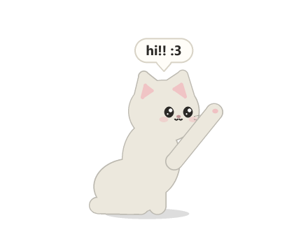
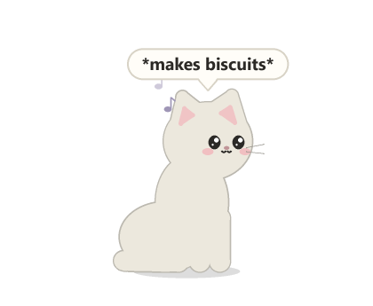
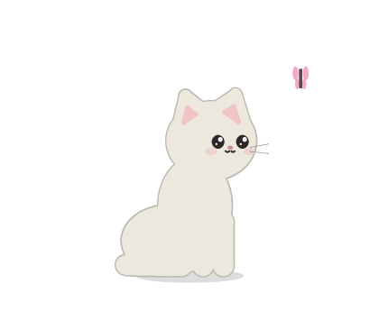
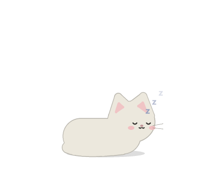
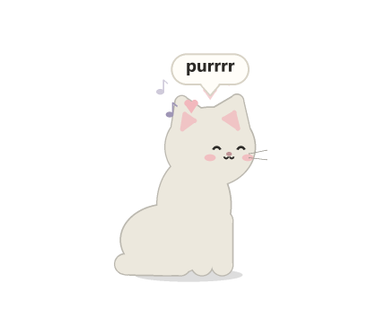
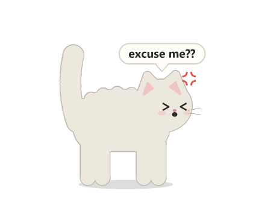
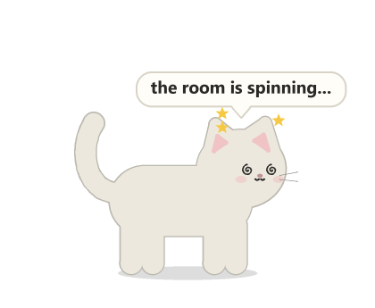
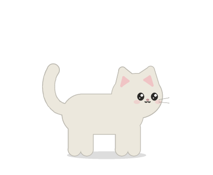

<div align="center">



# Charles Chocolate the Charles the IInd

**A small, soft, slightly judgemental cat who lives on your Windows desktop.**
She naps, she kneads, she chases butterflies, and if you scroll Reels for five
whole minutes she will walk over and close the tab herself.

[**Meet Charles →**](https://yad2thisyazm.github.io/charles-chocolate-the-charles-the-2nd/)

</div>

---

## What she does

| | |
|---|---|
|  | **Exists adorably.** Wanders around the bottom of your screen, sits, blinks, flicks an ear, and follows your cursor with her eyes. |
|  | **Makes biscuits.** Kneads with both paws while little purr-notes float up. |
|  | **Chases butterflies.** Watches one flutter by, swats at it, and misses. Every time. |
|  | **Loafs.** Curls up for a nap. Do not wake her. |
|  | **Loves pets.** Wiggle your cursor gently over her and she purrs and makes hearts. |
|  | **Hates pokes.** Click her and she puffs up. Poke her five times and she storms off to the other side of the screen. |
|  | **Gets dizzy.** Pick her up and shake her around and she lands with spinning eyes and stars. |

### The Reels Rule

Charles has one job. If you spend **5 minutes** scrolling **Instagram Reels,
YouTube Shorts, TikTok or Facebook Reels**:

1. at **4:00** she warns you: *"one more minute of reels..."*
2. at **5:00** she runs over, jumps up, hangs off your browser tab and **swats it closed**.
3. she lands, and says something like *"go touch grass :3"*.

Fine print:

- Only time spent **actively scrolling** counts (mouse wheel or arrow keys, at least once every 45 seconds).
- A break of more than a minute resets the timer.
- She watches the focused window *and* whatever window is under your mouse, so screen recorders stealing focus won't fool her.
- Works in Chrome, Edge, Brave, Firefox, Opera, Vivaldi, Arc and Zen, plus the TikTok / Instagram desktop apps.

## Install

Charles is **Windows only** (10 or 11) and needs **Python 3.10+**.

```bash
git clone https://github.com/yad2thisyazm/charles-chocolate-the-charles-the-2nd.git
cd charles-chocolate-the-charles-the-2nd
pip install -r requirements.txt
pythonw desk_cat.py
```

`pythonw` runs her without a console window. To have her start with Windows, put a shortcut to
`pythonw.exe desk_cat.py` in your Startup folder (`Win + R` → `shell:startup`).

## Using her

| Do this | She does this |
|---|---|
| Wiggle your cursor gently over her | Purrs, hearts |
| Left-click | Gets offended |
| Left-click 5 times quickly | Leaves |
| Drag | Dangles, then drops back onto the taskbar |
| Drag and shake | Dizzy |
| Right-click | Menu: reels timer, coat, size, test mission, quit |

**Coats:** Mochi (white), Ash (grey), Midnight (black), Ginger, Cream, Blue.
**Sizes:** Small, Medium, Large. Your choice is saved in `desk_cat_settings.json`.

### Testing the Reels Rule

Right-click → **Test the reels mission**. Now any reels page that's open for **20 seconds**
(scrolling or not) gets closed. It stays armed until she's closed something, so you can set
up a screen recording first and open reels after.

You can also run `python desk_cat.py --test` to shrink the real timer to 20 seconds.

## How she works

It's one Python file. She's drawn from scratch every frame with Pillow (supersampled
circles, rounded polygons and bezier "tubes"), and shown in a transparent, always-on-top
layered window. A background thread uses Windows UI Automation to read the browser's
address bar, and a low-level mouse hook notices when you scroll. When it's time, she finds
the active tab's close button through UI Automation and presses it. If that fails, she
falls back to <kbd>Ctrl</kbd>+<kbd>W</kbd>.

She never sends anything anywhere. Everything stays on your computer.

## Why "the IInd"?

Charles the Ist knocked a full glass of water onto a keyboard and quietly abdicated.

---

<div align="center">

<br>
<sub>made with love and an unreasonable number of bezier curves</sub>
</div>
